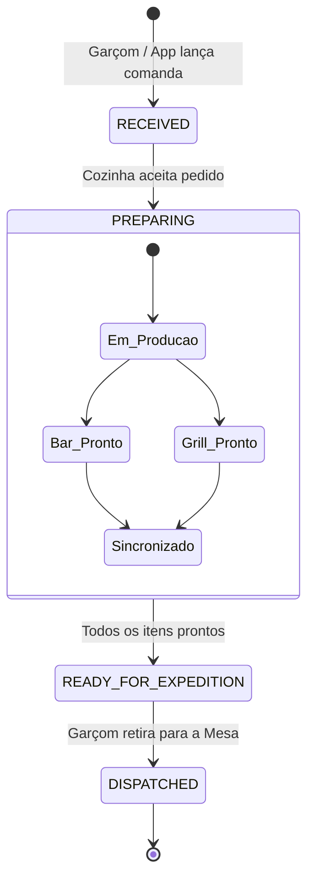

# 🍽️ GourmetFlow - Restaurant Kitchen Display System (KDS)
> **Sistema em Tempo Real de Gestão de Comandas, Estações de Cozinha e Expedição para Restaurantes e Delivery**  
> *Arquitetura Orientada a Eventos em TypeScript com suporte a WebSockets e Roteamento por Estação de Preparo*

---

## 💼 O Cenário de Negócio (Restaurantes & Bares de Alto Movimento)
Em restaurantes de alta rotatividade, churrascarias, pizzarias e cozinhas de delivery (Dark Kitchens), comandas em papel causam erros graves:
- Pedidos extraviados ou fora de ordem cronológica.
- Bebidas do bar que saem 15 minutos antes da comida ou esfriam na bancada.
- Falta de visibilidade de SLA de preparo (tempo de espera do cliente na mesa).

## 💡 A Solução: GourmetFlow KDS
O **GourmetFlow** divide a comanda automaticamente em **estações de trabalho independentes**:
1. **Parrilla/Grill:** Carnes e pratos quentes grelhados.
2. **Forno de Pizza:** Massas e pizzas.
3. **Bar:** Drinks, sucos e vinhos.
4. **Copa/Preparo Frio:** Saladas, entradas e sobremesas.
5. **Expedição:** Só notifica o garçom ou motoboy quando *todos* os itens da mesa estiverem sincronizados e prontos.



## 🛠️ Tecnologias
- **TypeScript 5 & Node.js 20**
- **Arquitetura Event-Driven (WebSocket Ready)**
- **Máquina de Estados de Pedidos de Restaurante**
- **Testes Unitários Automatizados com Node Runner Nativo**

## 🧪 Como Rodar
```bash
npm install
npm test
npm start
```
